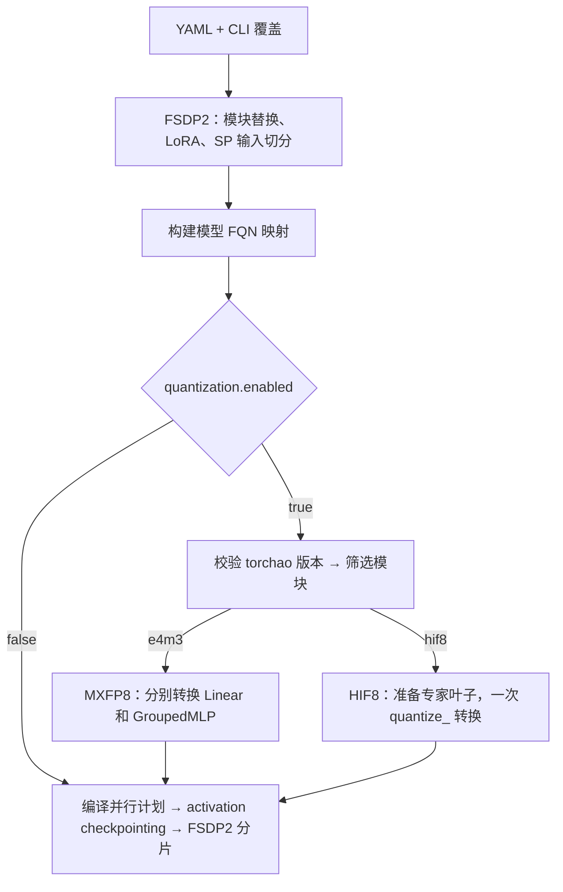
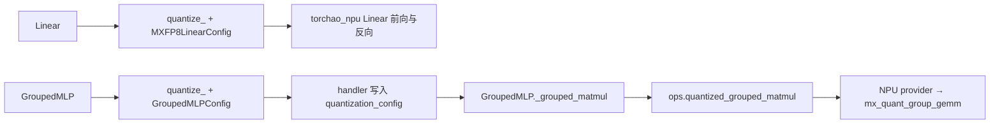
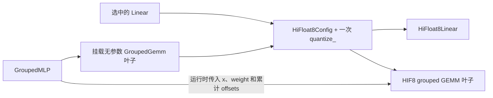

# TorchTurbo FP8 训练接入

当前实现面向 Ascend NPU 的 FSDP2 训练，使用 torchao 0.18 的 `quantize_` 作为模块转换入口，使用 `torchao_npu` 执行低精度计算。已验证环境使用 PyTorch 2.11、torch_npu 2.11.0.post3 和适配后的 torchao_npu 0.18。

## 已接入能力

| 功能 | MXFP8 | HIF8 |
|---|---|---|
| 配置值 | `format: e4m3` | `format: hif8` |
| 量化策略 | E4M3 数据格式，block-32 缩放，运行时量化 | Per-tensor 动态量化，输入、权重、输出梯度的目标幅值分别为 15、15、224 |
| Dense Linear | `quantize_(..., MXFP8LinearConfig)` | 组合配置中的 `HiFloat8LinearConfig` |
| MoE 专家 | 自定义 `GroupedMLPConfig` handler 配置专家，运行时通过 dispatcher 调用后端 grouped GEMM | 在专家内挂载无参数 `GroupedGemm`，用组合配置中的 `HiFloat8GMMConfig` 转换 |
| 反向精度 | `dgrad` 与 `wgrad` 独立控制 | 同左 |

`dgrad` 控制输入梯度 GEMM，`wgrad` 控制权重梯度 GEMM。某个开关关闭时，对应梯度 GEMM 回到原输入精度。低精度作用于 GEMM 计算，参数、优化器状态、EP 通信及 FSDP 通信继续沿用训练配置的精度。MXFP8 recipe 显式关闭低精度 all-gather。HIF8 的三个数值是量化目标幅值。

## 从配置到模块转换

```yaml
quantization:
  enabled: true
  backend: torchao_npu
  format: e4m3  # e4m3 or hif8
  linear: true
  moe: true
  dgrad: true
  wgrad: true
  include_fqns: []
  exclude_fqns: []
```

默认 `enabled: false`。其余默认值如上。`TorchTurboArgs.quantization_*` 和对应的 `--tt_quantization_*` 可覆盖 YAML，参数值为 `None` 时沿用 YAML。配置定义见 [QuantizationConfig](../src/torchturbo/engine/config.py#L121)，参数见 [TorchTurboArgs](../src/torchturbo/engine/args.py#L165)，完整示例见 [config_example.yaml](../scripts/runs/config_example.yaml)。



转换在 [FSDP2 backend](../src/torchturbo/engine/backends/fsdp2/backend.py#L481) 内启动，经 [modules.py](../src/torchturbo/quantization/modules.py#L18) 分发。[selection.py](../src/torchturbo/quantization/selection.py) 按模型原始 FQN 做通配匹配，排除优先于包含，默认跳过末段为 `lm_head`、`router`、`gate` 的模块。LoRA 模块定位到 `base_layer`，adapter 分支沿用原路径。格式目录中的选择器检查维度对齐，专家路径要求原生 `GroupedMLP`。

## 文件结构与修改目的

下面列出当前 FP8 接入涉及的主要文件。每个文件后用一句话概括职责。

~~~text
src/torchturbo/
├── engine/
│   ├── config.py                         # 定义 quantization 配置及取值校验
│   ├── args.py                           # 暴露 quantization_* 参数与 CLI 覆盖
│   └── backends/fsdp2/backend.py         # 在分片前调用量化转换入口
├── quantization/
│   ├── modules.py                        # 校验依赖并按格式分发转换
│   ├── selection.py                      # 根据模型 FQN、include/exclude 和默认规则选模块
│   ├── mxfp8/
│   │   ├── __init__.py                   # 协调 MXFP8 Linear 与专家转换
│   │   ├── recipe.py                     # 构造 E4M3 block-32 Linear 计算配置
│   │   ├── linear.py                     # 选择并调用 TorchAO 转换 Dense Linear
│   │   └── expert.py                     # 注册 GroupedMLP 转换 handler 并适配 MXFP8 grouped GEMM
│   └── hif8/
│       ├── __init__.py                   # 组合 Linear 与专家配置并执行一次 quantize_
│       ├── recipe.py                     # 统一 HIF8 量化范围和梯度开关
│       ├── linear.py                     # 选择 HIF8 Linear 并构造后端配置
│       └── expert.py                     # 选择专家并准备 stateless GEMM 转换目标
├── models/modules/moe/
│   ├── experts.py                        # 按专家格式调用普通或量化 grouped GEMM
│   └── grouped_gemm.py                   # 提供 HIF8 quantize_ 使用的无参数专家 GEMM 叶子
└── ops/
    ├── dispatcher.py                     # 声明量化 grouped GEMM API 并选择 provider
    └── providers/npu/
        ├── quantized_grouped_matmul.py   # 注册 MXFP8 NPU provider 并转调 TorchAO NPU
        ├── grouped_matmul.py             # 提供 BF16 等原精度 NPU grouped GEMM
        └── _fla_gdn/kkt.py               # 适配 GDN 的 fla_npu kernel 导入和参数接口

.gitignore                                # 排除本地运行结果和外部依赖工作目录

scripts/runs/config_example.yaml          # 展示 YAML 配置入口
scripts/runs/run_lf.py                     # 将 CLI 覆盖参数传给 engine config
src/torchturbo/engine/peft/lora.py          # 让模型 FQN 映射能定位 LoRA base layer
src/torchturbo/engine/backends/fsdp2/checkpoint/weight_saver.py # 避免量化包装影响权重保存路径
src/torchturbo/models/modules/loss/logits_loss.py # 处理 NPU fused CE 的 ignore_index 边界
tests/engine/test_args.py                  # 验证量化 CLI 参数解析与覆盖
tests/engine/test_engine_config_loading.py # 验证 YAML quantization 配置加载
tests/engine/test_hif8_conversion.py      # 覆盖格式转换、FQN 及 LoRA 目标
tests/ops/npu/test_torchao_npu_training.py # 覆盖 MXFP8 Linear 和 grouped GEMM 训练路径
tests/ops/npu/test_hif8_grouped.py        # 覆盖 HIF8 grouped GEMM，包括空专家
third_party/torchao_npu/hif8_gradient_switches.diff # 记录 HIF8 dgrad/wgrad 后端适配补丁
~~~

## 量化接入中的组件关系

TorchTurbo 的 ops dispatcher 和 TorchAO 的模块转换器承担不同职责。dispatcher 负责运行时根据设备、注册表和 override 选择算子 provider。quantize_ 负责模型准备阶段把命中的模块转换为量化模块或配置化模块。provider 则是 TorchTurbo 注册给 dispatcher 的具体 NPU 算子实现。

~~~mermaid
flowchart TD
    subgraph Prepare["模型准备阶段"]
        CFG["EngineConfig.quantization"] --> ENTRY["FSDP2 backend"]
        ENTRY --> ROUTE["quantization.modules.apply_quantization"]
        ROUTE --> FILTER["selection.py：按 FQN 筛选"]
        FILTER --> AO["torchao.quantization.quantize_"]
        AO -->|Linear module handler| AO_LINEAR["torchao_npu Linear"]
        AO -->|GroupedMLPConfig handler| MLP["GroupedMLP 写入计算策略"]
        AO -->|HiFloat8Config filter| HI_LEAF["HIF8 Linear / GroupedGemm 叶子"]
    end
    subgraph Runtime["训练运行阶段"]
        MLP --> MX_CALL["GroupedMLP._grouped_matmul"]
        MX_CALL --> API["ops.quantized_grouped_matmul"]
        API --> DISP["OpsDispatcher._dispatch"]
        DISP --> PROVIDER["TorchAONpuQuantizedGroupedMatmul"]
        PROVIDER --> MX_GMM["torchao_npu.mx_quant_group_gemm"]
        HI_LEAF --> HI_GMM["torchao_npu HiFloat8 grouped GEMM"]
        BASE["普通 ops.grouped_matmul 调用"] --> BASE_DISP["OpsDispatcher._dispatch"]
        BASE_DISP --> BASE_PROVIDER["TorchNpuGroupedMatmul"]
        BASE_PROVIDER --> NPU_OP["torch_npu.npu_grouped_matmul"]
    end
~~~

MXFP8 Dense Linear 由 quantize_ 转换后直接调用 TorchAO NPU 模块，不经过 TorchTurbo ops dispatcher。MXFP8 MoE 需要沿用 TorchTurbo 的 token 分发和专家布局，因此 GroupedMLP 仍发起 grouped GEMM，通过 dispatcher 进入 NPU provider，再由 provider 调用 TorchAO NPU kernel。HIF8 Dense Linear 和无参数 grouped GEMM 叶子由一个 HiFloat8Config 统一交给 quantize_，转换后的后端模块在运行时调用 TorchAO NPU HIF8 kernel。未量化的 grouped GEMM 仍走原有 grouped_matmul dispatcher/provider 路径。

## MXFP8 执行路径



- [mxfp8/linear.py](../src/torchturbo/quantization/mxfp8/linear.py) 选择并转换 Linear，[mxfp8/recipe.py](../src/torchturbo/quantization/mxfp8/recipe.py) 构建 E4M3、block-32、`jit_quant` recipe。
- [mxfp8/expert.py](../src/torchturbo/quantization/mxfp8/expert.py) 注册 `GroupedMLPConfig` handler。handler 在原专家模块上保存计算策略，gate-up 和 down 仍由 [GroupedMLP](../src/torchturbo/models/modules/moe/experts.py) 发起。
- [quantized_grouped_matmul.py](../src/torchturbo/ops/providers/npu/quantized_grouped_matmul.py) 注册 NPU provider，并处理零 token 输入。后端收到每个专家的 token counts，使用 `group_list_type=1`。

## HIF8 执行路径



- [hif8/__init__.py](../src/torchturbo/quantization/hif8/__init__.py) 把 [Linear 配置](../src/torchturbo/quantization/hif8/linear.py) 和 [专家配置](../src/torchturbo/quantization/hif8/expert.py) 放入同一个 `HiFloat8Config`。`filter_fn` 只命中选中的 Linear 和新挂载的专家叶子。
- [grouped_gemm.py](../src/torchturbo/models/modules/moe/grouped_gemm.py) 定义无参数转换目标。专家权重仍由 `GroupedMLP` 持有，参数名和 state_dict 键沿用原结构。执行时专家模块把 token counts 转成累计 offsets，再与输入和权重一起传入叶子。
- [hif8/recipe.py](../src/torchturbo/quantization/hif8/recipe.py) 统一 Linear 和专家的量化幅值及梯度开关。后端梯度开关的适配见 [hif8_gradient_switches.diff](../third_party/torchao_npu/hif8_gradient_switches.diff)。

## 代码边界与验证状态

| 文件 | 职责 |
|---|---|
| [logits_loss.py](../src/torchturbo/models/modules/loss/logits_loss.py) | NPU fused CE 的忽略标签兼容。混合有效标签与 `-100` 时，旧路径在消融中报设备错误。 |
| [kkt.py](../src/torchturbo/ops/providers/npu/_fla_gdn/kkt.py) | GDN 前向的 NPU kernel 接口适配。旧路径在当前环境导入失败。 |

Linear/Expert 拆分后的相关验证通过 69 项，覆盖转换、反向开关、空专家和 LoRA 等路径。35B 的 45 步整模对照中，BF16、MXFP8、HIF8 分别约为 2.833、3.327、3.377 秒/步，三组峰值已分配显存均约 70.7 GiB。MXFP8 逐步 loss 最大相对偏差约 1.03%，HIF8 约 3.20%，超过该轮 2% 的逐步门槛。单模块提速随 shape 变化，整模性能与显存收益仍待验证。

更多实现与验证细节见 [TorchAO NPU 后端](torchao_npu_backend.md) 和 [HIF8 训练](hif8_training.md)。

